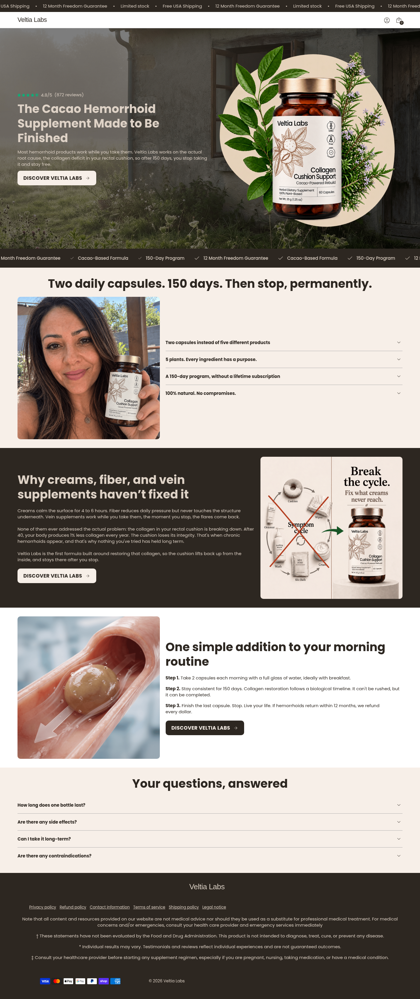

# Veltia Labs

[Download the Shopify theme ZIP](downloads/veltia-labs-shopify.zip) · [Open desktop screenshot](docs/veltia-1440.png) · [Open mobile screenshot](docs/veltia-390.png)

To download the ZIP on GitHub, open the link above and choose **Download raw file**.




Recreation of the homepage supplied at https://venalyslab.com/, with Veltia Labs branding and lightly refreshed headings. The original section order, responsive layouts, colors, fonts, background photography, core product messaging, and FAQ structure are retained. Four bottle-label images were edited for the new brand; these are image edits rather than pixel-identical originals.

## Run locally

Node.js 20+ and Python 3 are required. There are no npm dependencies to install.

```sh
cd /workspace/pdp2
npm run dev
```

The server defaults to port 3000; set `PORT` to change it. The static preview contains the homepage and its menu, accordion, and empty-cart interactions. Product, account, policy, and checkout destinations run on Shopify after the theme is uploaded; the local preview does not implement Shopify's backend.

## Build and upload to Shopify

```sh
npm run build
```

Upload `dist/veltia-labs-shopify.zip` to the **new** store through **Online Store → Themes → Import theme → Upload ZIP file**. This creates a draft theme; uploading does not publish it.

Open **Customize → Veltia Labs homepage** and select the new store's product for the Discover buttons. The fallback handle is `collagen-cushion-support-capsules`. Product URLs, cart, account, and policy links stay on the current store's domain. Product and cart templates use Shopify's catalog, prices, variants, and checkout. Populate the new store's product and policy content in Shopify; this project does not copy catalog or customer records from the old store.

Preview the draft theme and verify the selected product, store policies, account links, and a test checkout in Shopify before publishing. Product/cart supporting templates are basic native Shopify templates; this recreation targets the supplied homepage, not the old store's separate product page.

## Files

- `public/`: standalone homepage, styles, fonts, and images.
- `shopify/`: Liquid layout, homepage section, shared header/footer, and supporting templates.
- `dist/veltia-labs-shopify.zip`: generated uploadable theme.
- `docs/veltia-390.png`, `docs/veltia-768.png`, `docs/veltia-1440.png`: full-page captures at mobile, tablet, and desktop widths.
- `docs/validation.json`: browser validation results.
- `docs/theme-check.json`: Shopify CLI theme validation results.

Edit homepage copy/layout in both `public/index.html` and `shopify/sections/veltia-home.liquid`. Shared styling is in `public/veltia.css`; behavior is in `public/veltia.js`. `npm run build` copies these assets into the Shopify package.

Original third-party analytics and Shopify app scripts are excluded. The new store's apps should be configured in its own admin. Existing ratings, guarantee language, and product statements were carried over from the supplied page; edit them in the homepage section when the new store's content differs.

## Validation

- Browser checks at 390, 768, and 1440 px: all images loaded, no horizontal overflow or JavaScript errors, no old branding in the rendered markup.
- FAQ opening/closing, cart opening/closing, and mobile menu/Escape behavior passed.
- `npm run build` passed.
- Shopify CLI `theme check` passed with zero errors and zero warnings.

The theme has not been uploaded to or tested inside the new Shopify store. Live checkout and third-party app integrations require validation there.
