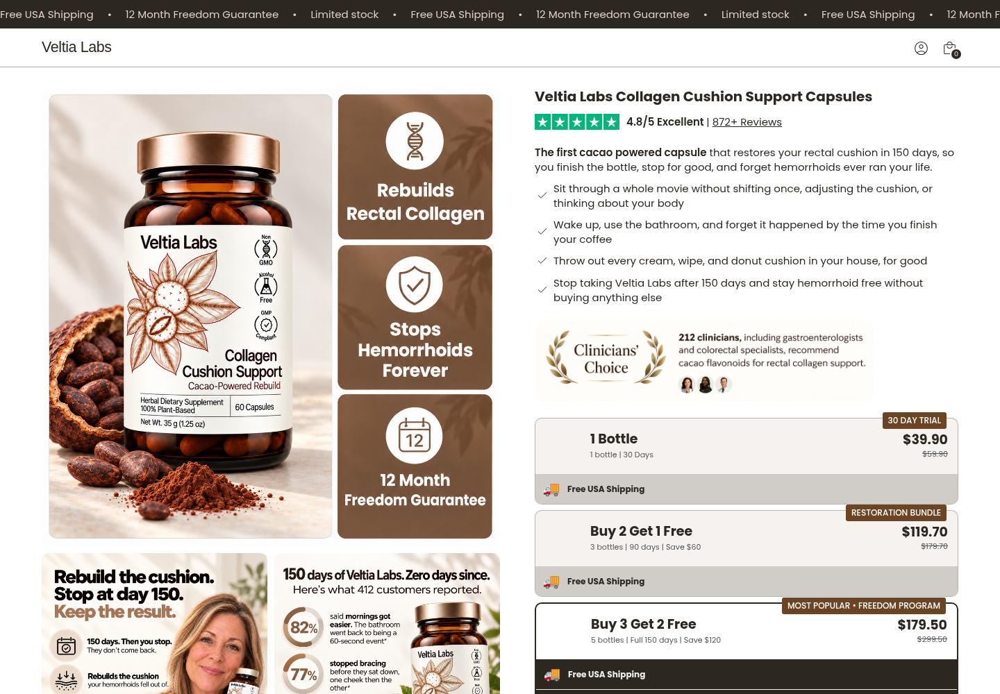

# Veltia Labs

[View all refreshed images](docs/image-refresh-overview.jpg) · [Download the Shopify theme ZIP](downloads/veltia-labs-shopify.zip) · [Product desktop preview](docs/product-1440-top.png) · [Product mobile preview](docs/product-390.png) · [Homepage preview](docs/veltia-1440.png)

On GitHub, open the ZIP link and choose **Download raw file**.



Recreation of the supplied homepage and [product page](https://venalyslab.com/products/collagen-cushion-support-capsules). Both retain their original section order, responsive layouts, colors, fonts, and core messaging, with Veltia Labs branding and light copy updates. The product page includes all 19 original sections, the nine-image product gallery, three program choices, ingredients, reviews, FAQs, ebook bonus, and guarantee sections.

## Run locally

Node.js 20+ and Python 3 are required. There are no npm dependencies to install.

```sh
cd /workspace/pdp2
npm run dev
```

The server defaults to port 3000; set `PORT` to change it. Open `/` for the prelander and `/products/collagen-cushion-support-capsules` for the product page. The homepage's Discover buttons lead to the product preview.

The local preview supports the gallery, offer selection, add/remove cart items, navigation, FAQs, and expandable reviews/ebook contents. Its cart uses session storage and cannot take payment. The Shopify theme posts actual catalog variant IDs to Shopify's native cart.

## Build and upload to Shopify

```sh
npm run build
```

Upload `dist/veltia-labs-shopify.zip` to the new store through **Online Store → Themes → Import theme → Upload ZIP file**. Uploading creates a draft theme and does not publish it.

1. Create or configure the store's product and the actual 1-, 3-, and 5-bottle program SKUs. The reference offers are $39.90, $119.70, and $179.50. Set actual product prices and optional compare-at prices in Shopify. Multi-bottle products need the correct bundle inventory/fulfillment configuration; adding a label to a product does not create a physical bundle.
2. In **Customize → Homepage → Veltia Labs homepage**, select the product linked by Discover buttons. The fallback handle is `collagen-cushion-support-capsules`.
3. Open the product template in the theme editor. Under **Veltia Labs product page**, select the Trial, Restoration, and Freedom Program products. Trial defaults to the current product. Restoration and Freedom remain unavailable until their products are selected. Prices, variants, and availability come from the selected catalog products; no old-store IDs or client-calculated discounts are submitted.
4. Configure free shipping, ebook delivery, guarantee fulfillment, store policies, and account settings in the new Shopify store. The ebook artwork and contents list are included; the actual downloadable ebook file was not supplied by the reference page.
5. Preview the draft theme and complete a test checkout in Shopify before publishing.

The theme does not copy catalog/customer records or automatically configure discount, digital-delivery, or shipping apps. All navigation and purchase links use the new store's domain.

## Assets and content

Both pages now include 49 freshly remade image variations, replacing 51 source assets (two responsive pairs share artwork). Product graphics, lifestyle and customer imagery, ingredient illustrations, scientific diagrams, the ebook cover, video posters, and guarantee artwork retain their original purpose with subtle visual changes. Existing customer identities and the numerical information are preserved. Ten brand, publication, and interface marks remain unchanged. Images use optimized WebP files; text-heavy artwork is lossless. See [the image inventory](docs/image-refresh.json) for coverage and file hashes.

The four original testimonial videos are retained and streamed from the existing Shopify CDN. Their footage/audio was not edited and can still contain the original branding. The old store's analytics, tracking, app configuration, and app credentials are excluded. The recreated offer interface uses native Shopify products rather than requiring the original bundle app.

Review counts, testimonial content, ingredient statements, and guarantee language were carried over from the reference; update them in the theme source if the new store's content differs.

## Files

- `public/index.html`: standalone homepage.
- `public/product.html`, `product.css`, `product.js`, `product-extras.js`: standalone product page and interactions.
- `public/assets/`: local fonts, images, and the MIT-licensed Splide 4.1.2 carousel library from its official npm package.
- `shopify/sections/veltia-product.liquid`, `shopify/snippets/veltia-product-main.liquid`: the complete Shopify product page and catalog bindings.
- `shopify/sections/veltia-home.liquid`: Shopify homepage.
- `shopify/`: shared layout/header/footer and native cart/page templates.
- `dist/veltia-labs-shopify.zip`: generated theme package.
- `downloads/veltia-labs-shopify.zip`: committed download copy of the latest package.
- `docs/product-1440.png`, `product-768.png`, `product-390.png`: full product-page screenshots; `*-top.png` contains a larger hero view.
- `docs/veltia-1440.png`, `veltia-768.png`, `veltia-390.png`: homepage screenshots.
- `docs/product-validation.json`, `docs/validation.json`, `docs/theme-check.json`: validation evidence.

Edit shared styling in `public/veltia.css` and shared behavior in `public/veltia.js`. Keep standalone HTML and Liquid section content in sync when editing copy/layout. `npm run build` copies all required assets into the Shopify package.

## Validation scope

The browser checks cover mobile, tablet, and desktop layouts; image loading; gallery navigation; all three offers; add/remove cart behavior; FAQ, review, and ebook expansion; internal anchors; overflow; and JavaScript errors. Offline Liquid fixtures verify catalog variant IDs, actual prices, variant changes, unavailable bundle behavior, and a native cart POST intercepted locally. Shopify CLI theme validation checks the packaged Liquid/JSON and asset references.

The theme has not been uploaded to the new Shopify store. Live checkout, actual inventory, shipping, ebook delivery, and store-specific integrations require testing there.
